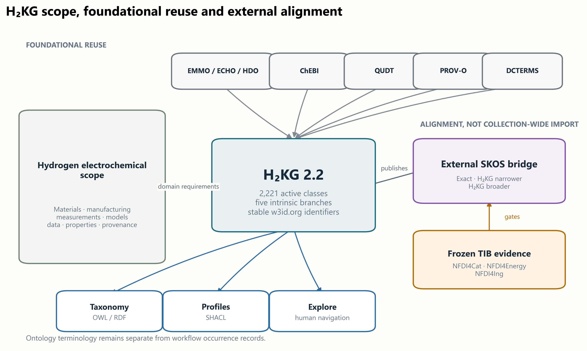
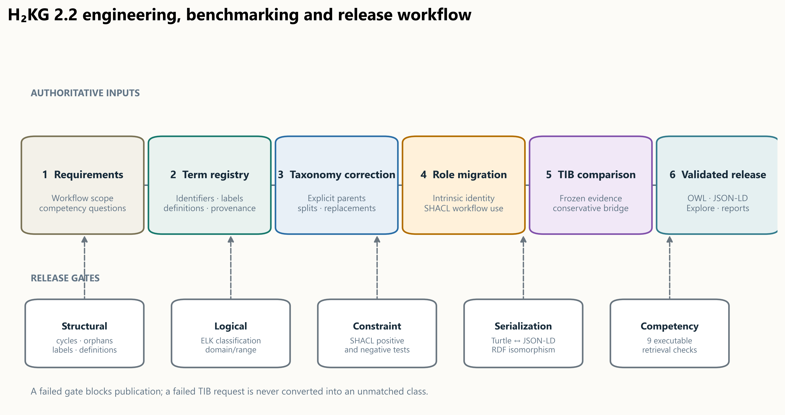
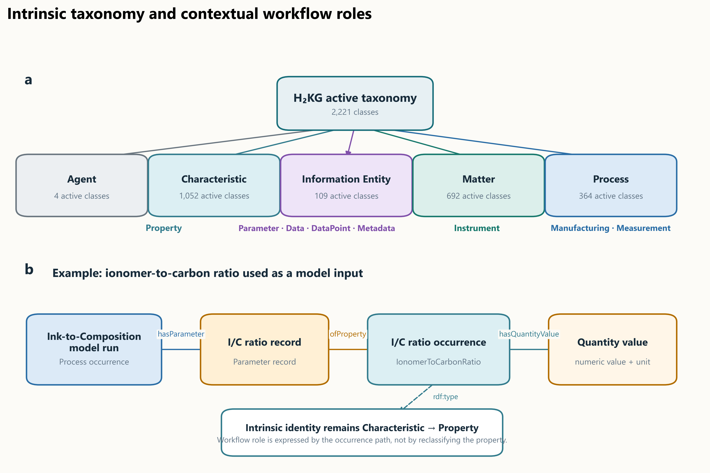
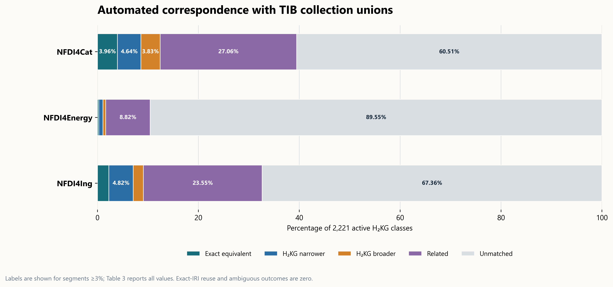
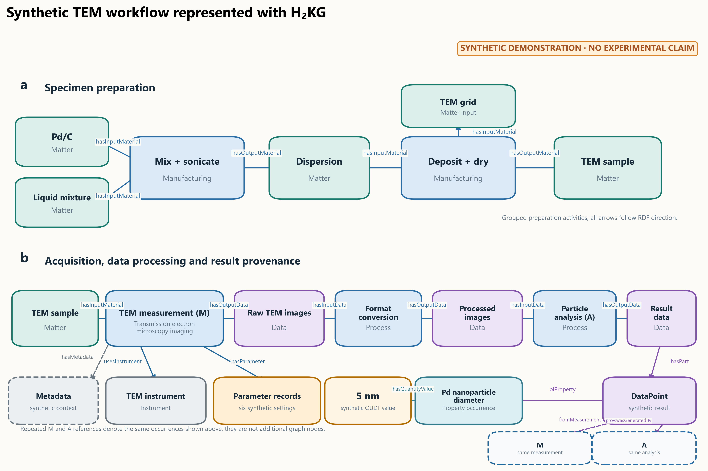

# A domain-specific ontology for interoperable hydrogen electrochemical research workflows

Marjan Kohandani¹, Mohammad J. Eslamibidgoli¹,²*, Said Fathallah³, Michael H. Eikerling¹,², and Kourosh Malek¹,²

¹ Theory and Computation of Energy Materials, Institute of Energy Technologies (IET-3), Forschungszentrum Jülich GmbH, Jülich, Germany

² Chair for Theory and Computation of Energy Materials, Faculty of Georesources and Materials Engineering, RWTH Aachen University, Aachen, Germany

³ Materials Data Science and Informatics, Institute for Advanced Simulation (IAS-9), Forschungszentrum Jülich GmbH, Jülich, Germany

*Correspondence: m.eslamibidgoli@fz-juelich.de

## Abstract

Hydrogen electrochemical research combines materials, manufacturing, operating conditions, characterization, models, datasets, and derived quantities, but these elements are often recorded with incompatible terminology and incomplete context. H₂KG is a domain-specific ontology that provides persistent concepts and relations for representing these workflows while reusing established chemical, quantity, unit, provenance, and data-management vocabularies. Version 2.2.0 contains 2,221 active classes organized under five intrinsic branches and separates scientific properties from their contextual use as parameters. Structural checks, external reasoning, Shape Constraint Language validation, serialization parity, and nine competency queries were applied to the release. An automated benchmark compared every active class with ontologies in three collections indexed by the TIB Terminology Service, distinguishing exact equivalence, directional specialization, relatedness, and absence. A fully synthetic transmission-electron-microscopy record demonstrates how material preparation, acquisition, parameter records, image processing, provenance, and a quantity value can be represented without treating illustrative values as experimental evidence. H₂KG supports explicit, testable data semantics; it does not by itself make a dataset FAIR.

## Introduction

Hydrogen electrochemical research depends on information that crosses experimental and computational boundaries. A catalyst-layer study may combine precursor identity, ink composition, manufacturing history, electrode architecture, cell operating conditions, microscopy or spectroscopy settings, numerical models, raw and processed datasets, and derived performance or microstructural quantities. These records are commonly distributed among laboratory notebooks, spreadsheets, instrument exports, scripts, publications, and local databases. Even when the same scientific quantity is present, differences in labels, units, granularity, and missing provenance can prevent reliable discovery and comparison. This is a general research-data problem, but hydrogen technologies intensify it because materials, processes, measurements, and models must be interpreted together.

The Findable, Accessible, Interoperable and Reusable (FAIR) principles provide goals for improving digital research objects, but they do not prescribe a domain model or guarantee scientific comparability [1]. A vocabulary becomes more reusable when its terms have stable identifiers, explicit definitions, machine-readable relations, versioning, and governance [2]. An ontology adds formally stated classes and properties to such a vocabulary [24], allowing data producers to express that a transmission electron microscopy measurement used a particular specimen and instrument, generated an image dataset, and supported an analysis that produced a value for a specified property. The ontology supplies shared semantics; completeness, measurement quality, and fitness for a particular analysis remain responsibilities of the data producer and consumer.

Several established semantic resources cover parts of this problem. The Elementary Multiperspective Material Ontology (EMMO) provides a foundational framework for materials science [10], and its Electrochemistry Domain Ontology describes electrochemical systems, materials, methods, and data [11]. The Hydrogen Domain Ontology addresses hydrogen-related research-data concepts [12], whereas BattINFO provides terminology and patterns developed for battery research [13]. Chemical Entities of Biological Interest (ChEBI) supplies identifiers and classifications for chemical entities [8]. Quantities, Units, Dimensions and Types (QUDT) represents quantity values, quantity kinds, units, and dimensions [9]. The Provenance Ontology (PROV-O) and Dublin Core Metadata Terms provide general provenance and descriptive metadata relations [6,7]. Materials-focused ontologies such as the Platform Material Digital Core Ontology and the Materials Data Science Ontology illustrate broader efforts to connect materials, processes, data, and analysis [14,15]. These resources are complementary rather than interchangeable: none alone supplies the hydrogen-electrochemistry workflow coverage required here.

**Table 1. Related semantic resources and their relationship to H₂KG.**

| Resource | Principal scope | Relationship to H₂KG |
| --- | --- | --- |
| EMMO | Foundational materials-science concepts | Foundational alignment and reused conceptual patterns; not a substitute for H₂KG domain terms |
| Electrochemistry Domain Ontology | Electrochemical systems, materials, methods, and data | Reused and aligned electrochemistry concepts where semantic scope agrees |
| HDO | Hydrogen research data and metadata | Reused data-management and hydrogen-domain anchors where available |
| ChEBI | Chemical entities and chemical classification | External identifiers for chemical substances where applicable |
| QUDT | Quantities, quantity kinds, units, and dimensions | Imported schema for explicit quantity-value and unit representation |
| PROV-O | Provenance entities, activities, and agents | Imported provenance relations for generation and attribution |
| DCTERMS | General resource description | Bibliographic, identifier, date, format, and source metadata |
| BattINFO | Battery-domain semantic models | Comparative electrochemical resource with adjacent rather than identical scope |
| Metadata4Ing and Open Energy Ontology | Engineering data generation and energy-system analysis | Comparative resources represented in NFDI collection benchmarking |
| TIB Terminology Service | Cross-domain ontology discovery and programmatic access | Discovery corpus and frozen source for reproducible external benchmarking |

Ontology catalogues are therefore important both for term reuse and for establishing where a new domain ontology adds coverage. The TIB Terminology Service provides searchable and programmatic access to ontologies, classes, synonyms, definitions, and hierarchy information across scientific communities [16]. It also groups resources into collection views. Three collections were selected for the present comparison. NFDI4Cat brings together resources relevant to catalysis, characterization, materials, and processes; prior analysis has shown the diversity of ontologies needed for catalysis research-data management [17]. NFDI4Energy covers resources used for energy-system data and modeling, including the Open Energy Ontology [18]. NFDI4Ing covers engineering research processes and research-data generation, including Metadata4Ing [19]. These are catalogue collections, not single ontologies, and membership does not imply that every listed ontology is a dependency of H₂KG.

H₂KG was developed to connect reusable terminology for hydrogen electrochemical materials, manufacturing, measurements, datasets, model inputs and outputs, properties, and provenance. Despite its name, the released H₂KG artifact is an ontology; workflow occurrence graphs built with its terms are separate instance data. The present work addresses four questions: whether the ontology has a complete and coherent intrinsic taxonomy; whether contextual workflow use can be represented without confusing properties with parameter records; how its vocabulary corresponds to major ontology collections relevant to catalysis, energy, and engineering; and whether a characterization workflow can be instantiated and validated using only explicit, traceable relations. The contributions are the H₂KG 2.2.0 taxonomy and workflow-profile model, a reproducible validation and benchmarking package, a conservative external mapping bridge, and a synthetic transmission electron microscopy example that demonstrates the intended record pattern without making an experimental claim.



**Figure 1. H₂KG scope and semantic architecture.** H₂KG supplies hydrogen-electrochemistry terminology and workflow relations while reusing selected foundational vocabularies and publishing conservative external mappings separately. TIB collection membership is used for discovery and benchmarking, not as an ontology import mechanism.

## Methods

### Scope and requirements

H₂KG was engineered as a domain ontology for proton-exchange-membrane fuel-cell and water-electrolysis research, while retaining generic concepts that can be reused in adjacent hydrogen electrochemical contexts. Scope requirements were derived from the need to represent: material and component identity; preparation and manufacturing; experimental and computational processes; measurements and instruments; input settings; raw, intermediate, and result datasets; derived characteristics; quantity values and units; and provenance or source metadata. The ontology namespace is `https://w3id.org/h2kg/hydrogen-ontology#`. Persistent class identifiers were preserved across the 2.2 correction, including the public anchors `Matter`, `Process`, `Manufacturing`, `Measurement`, `Instrument`, `Parameter`, `Data`, `DataPoint`, `Property`, and `Metadata`.

The term H₂KG denotes the maintained ontology resource and its release ecosystem. It does not imply that the ontology file contains experimental records. The canonical taxonomy contains classes and properties but no named taxonomy individuals. Workflow records are separate occurrence graphs whose individuals are typed with H₂KG classes. This separation permits stable terminology to be released independently from datasets that use it.

Nine competency questions were encoded as executable checks. They test retrieval of electron-microscopy and tomography methods; retrieval of microscopy, diffraction, and tomography datasets; canonical identity of characteristics used in different workflow roles; transmission-electron-microscopy workflow compatibility; retrieval of the ink-to-composition profile; retrieval of measurements with membrane-electrode-assembly subjects; software-use representation; and placement across core, fuel-cell, and water-electrolysis modules. The complete questions and expected answers are provided in Supplementary Table S4.

### Vocabulary acquisition and reuse

Candidate terminology was assembled from hydrogen-electrochemistry workflows and supporting schemas, then normalized into preferred labels, strict alternate labels, definitions, source provenance, and semantic roles. Reuse was preferred when an external term had compatible identity and scope. QUDT was used for units and quantity kinds, PROV-O for provenance, DCTERMS for general metadata, ChEBI for suitable chemical entities, and EMMO, the Electrochemistry Domain Ontology, and HDO for compatible higher-level or domain concepts. The release asserts imports only for the QUDT schema and PROV-O. Other reuse and alignment decisions are expressed by original external identifiers or in a separate mapping bridge; entire TIB collections are not imported.

Each local class was assigned a stable Internationalized Resource Identifier, one preferred English label, optional strict synonyms, a definition, an explicit primary parent, an intrinsic top branch, a governance status, and provenance. Symbols and notations were represented separately from synonyms. Source-specific wording was retained as notes or compatibility metadata when it did not denote a reusable class. Deprecated identifiers remain resolvable in a compatibility graph, but they are excluded from active taxonomy expansion and benchmark denominators.

### Taxonomy construction and version 2.2 correction

The taxonomy was organized under five intrinsic branches: `Agent`, `Characteristic`, `InformationEntity`, `Matter`, and `Process`. Familiar workflow anchors remain within those branches. For example, `Property` is under `Characteristic`; `Parameter` and `DataPoint` are information entities; `Instrument` is a material entity under `Matter`; and `Manufacturing` and `Measurement` are processes. Intermediate classes were introduced where a direct jump from a specific class to a top branch obscured scientific meaning, including solution, oxide-material, milling-process, chemical-reaction-process, operating-characteristic, electrical-characteristic, rheological-characteristic, and related groupings.

Version 2.2 used a machine-readable correction registry rather than publication-time keyword placement. The registry covers 156 parent decisions and 470 definition decisions involving 544 unique classes. Each decision has an explicit disposition: apply, retain, split, replace, or deprecate when source evidence cannot establish a single scientific identity. Definitions were rewritten to describe the intrinsic concept rather than a temporary workflow use. Demonstrated duplicates were consolidated; identity-changing cases were split or replaced; and scientifically underdetermined terms were deprecated rather than assigned a guessed parent. The build rejects active classes lacking an explicit parent or definition.

### Intrinsic identity and contextual workflow use

A central modeling requirement was to separate what a scientific concept *is* from how a particular workflow *uses* it. Temperature, pressure, thickness, porosity, and ionomer-to-carbon ratio are characteristics even when selected as model inputs or experimental settings. They therefore remain under `Characteristic > Property`. A `Parameter` is an information record that states a selected setting in a process occurrence. Its `ofProperty` relation points to a property occurrence, which carries the quantity value and QUDT unit. The canonical pattern is:

```turtle
:itcRun a h2kg:InkToCompositionModel ;
    h2kg:hasParameter :icRatioRecord .

:icRatioRecord a h2kg:Parameter ;
    h2kg:ofProperty :icRatioOccurrence .

:icRatioOccurrence a h2kg:IonomerToCarbonRatio ;
    h2kg:hasQuantityValue :icRatioValue .
```

Class-level workflow assertions from earlier releases were converted to Shape Constraint Language (SHACL) profile constraints [5]. A profile can require a parameter record whose `ofProperty` target has a specified H₂KG type without asserting that the property class itself is a parameter. The same property may consequently be an input setting in one profile and the target of a result `DataPoint` in another. A relation-migration registry records the disposition of every legacy assertion, including conversions of materials to `hasInputMaterial`, software to `usesSoftware`, reference electrodes to `usesReferenceElectrode`, and normalization bases to `normalizedTo`.

### TIB collection benchmark

The benchmark used a frozen TIB Terminology Service catalogue snapshot retrieved on 14 October 2026. The snapshot contained 143 unique ontologies represented by 165 collection memberships: 24 in NFDI4Cat, 27 in NFDI4Energy, and 114 in NFDI4Ing. An ontology occurring in more than one collection was evaluated in each collection block but counted once among unique ontologies. Imported visibility was recorded separately from native defining-ontology membership.

All 2,221 active H₂KG classes were queried by preferred label, alternate labels, and normalized lexical forms. Candidate evidence included original ontology identifier, active or obsolete state, preferred and alternate labels, definitions, direct parents, ancestor paths, and an inferred coarse semantic role. Role categories were `Matter`, `Process`, `Measurement`, `Instrument`, `Data`, `Characteristic`, and `Agent`. Evidence retrieval failures were treated as build failures rather than semantic non-matches.

The deterministic classifier assigned one outcome to each H₂KG class for each ontology and collection. `exact_iri_reuse` required an identical stable identifier. `machine_exact_equivalent` required compatible labels, roles, definitions, hierarchy, scientific scope, material state, and entity/value granularity. `h2kg_narrower` meant that H₂KG added defensible scientific restrictions to a broader external concept; `h2kg_broader` meant the reverse. `related_non_equivalent` recorded a scientifically meaningful candidate for which equivalence or subsumption was not defensible. `unmatched` required successful completion of the native-term search with no candidate. Candidate ties or role conflicts were conservatively assigned as related rather than forced into equivalence. The collection-level outcome was the strongest defensible relation found in any member ontology after deduplication.

The benchmark and the published bridge were deliberately separated. Benchmark outcomes describe correspondence evidence. The bridge publishes only high-confidence `skos:exactMatch`, `skos:broadMatch`, and `skos:narrowMatch` statements that pass stricter assertion gates [4]. Related candidates remain non-asserted evidence, and no automated `owl:equivalentClass`, `owl:sameAs`, external subclass axiom, or collection-wide import is generated.

### Validation

Validation combined structural, logical, constraint, serialization, and competency checks. Structural tests detected subclass cycles, orphan classes, duplicate active preferred labels, missing definitions, missing explicit parents, unresolved class identities, invalid local file identifiers, and incompatible intrinsic roles. The ontology was expressed in the Web Ontology Language [23], and the ELK reasoner was used for external logical classification [20]. SHACL validated taxonomy requirements and occurrence-level profiles. Turtle and JavaScript Object Notation for Linked Data (JSON-LD) serializations were parsed with RDFLib and compared as isomorphic Resource Description Framework graphs [3,21]. ROBOT-based quality-control artifacts were produced alongside the release [22]. The nine competency checks were executed against the generated taxonomy and workflow-profile registries.

The validation criteria concern representational consistency and declared profile constraints. They do not establish that an experimental method was executed correctly, that a reported value is scientifically accurate, or that two datasets are comparable without further study-specific conditions.



**Figure 2. Ontology engineering and release workflow.** Source terminology and reuse candidates are curated into an authoritative registry; explicit taxonomy corrections and workflow-role migrations generate the ontology and SHACL profiles; frozen TIB evidence supports benchmarking and a conservative SKOS bridge; structural, logical, serialization, constraint, and competency checks gate the release.

### Synthetic transmission electron microscopy demonstration

A synthetic transmission electron microscopy (TEM) record was constructed to test the end-to-end profile without implying an experimental source. The workflow contains a palladium-on-carbon material, liquid mixture, carbon-coated copper grid, mixing, sonication, deposition, drying, a TEM specimen, a TEM measurement and instrument, six acquisition-setting records, raw and processed image datasets, manual particle analysis, a result dataset, a `DataPoint`, a palladium nanoparticle diameter property occurrence, and a QUDT quantity value. All labels and values are illustrative. The representative result `5 nm` is marked synthetic in the record, figure, table, metadata, and validation report.

The TEM SHACL profile requires a correctly typed measurement occurrence, at least one material input, an instrument, a raw image output, a provenance-linked result chain, and compatible quantity-value representation when a numeric result is present. Parameters are represented as records linked through `ofProperty`. Four negative variants were generated by removing or changing one required component: measurement type, measurement output, result-property type, or quantity-value unit. These tests distinguish profile conformance from scientific validation.

## Results

### Ontology content and taxonomy

H₂KG 2.2.0 contains 2,221 active local classes and 165 deprecated compatibility classes. The active taxonomy contains 23 object properties, one datatype property, nine annotation properties, and no named taxonomy individuals. The active classes are distributed among five intrinsic top branches: 4 under `Agent`, 1,052 under `Characteristic`, 109 under `InformationEntity`, 692 under `Matter`, and 364 under `Process`. These counts sum to the active-class total and describe classification breadth, not ontology quality by themselves.

**Table 2. H₂KG 2.2 content and quantitative quality metrics.**

| Metric | Result |
| --- | ---: |
| Active local classes | 2,221 |
| Deprecated compatibility classes | 165 |
| New structural classes introduced by the corrected taxonomy | 157 |
| Object properties | 23 |
| Datatype properties | 1 |
| Annotation properties | 9 |
| Named taxonomy individuals | 0 |
| Active classes with preferred label, definition, and explicit parent coverage | 100% |
| Legacy workflow assertions classified | 4,418 of 4,418 (100%) |
| Canonical property–parameter conflations | 0 |
| Canonical class-to-class workflow assertions | 0 |
| Subclass cycles, orphan classes, or duplicate active labels | 0 |
| Local file identifiers or unresolved active classes | 0 |
| Competency checks passed | 9 of 9 |
| SHACL validation | Conforms |
| Turtle/JSON-LD graph parity | Isomorphic |
| External reasoner | Passed |

The correction registry accounts for all 626 planned parent and definition decisions. Of these decisions, 455 were applied directly, six retained an existing scientifically adequate decision, seven replaced a term, one split an overloaded identity, and 157 deprecated source-dependent terms whose identity could not be established safely. Because several decisions affect the same class, decision counts are not class counts. Active-term preferred-label, definition, and parent coverage reached 100%; top roots are exempt from having a local parent.



**Figure 3. Intrinsic taxonomy and contextual parameter use.** The five active top branches preserve stable workflow anchors. A scientific quantity remains a `Property`; a process uses a separate `Parameter` record, which points through `ofProperty` to a property occurrence carrying its QUDT quantity value. Workflow use therefore does not change taxonomy identity.

### Workflow-role migration and technical quality

All 4,418 legacy workflow assertions received a recorded migration outcome. Of these, 4,416 became profile relations and two were retained as explicitly unsupported, documented legacy cases rather than converted into unjustified canonical semantics. The set included 1,163 legacy `hasParameter` assertions. Migration produced 1,143 parameter-record/property paths; the remaining parameter-labelled targets were reassigned according to intrinsic identity, for example as material inputs, subprocesses, reference scales, or normalization records. No active characteristic class is typed as `Parameter` in the canonical artifacts, and no canonical object-property assertion uses two ontology classes as if they were workflow occurrences.

Structural validation found no subclass cycles, orphan active classes, duplicate active preferred labels, missing definitions, fallback taxonomy placements, unresolved active identities, or local file identifiers. SHACL checks conformed; the external reasoner completed successfully; Turtle and JSON-LD outputs were graph-isomorphic; and all nine competency checks returned their expected results. These metrics establish internal consistency against the declared design and tests. They should not be interpreted as proof that every possible hydrogen concept is present or that every external mapping is scientifically final.

### Correspondence with TIB-indexed ontology collections

The collection benchmark assigned exactly one outcome to every active H₂KG class in each collection-level union. Exact-IRI reuse was zero because H₂KG retains stable local identifiers, and no semantic abstentions remained after successful evidence retrieval. NFDI4Cat had the largest strict-equivalence share and the largest total of exact or directional correspondences. NFDI4Ing also contained substantial related and directional coverage, consistent with H₂KG's representation of processes, measurements, instruments, data generation, and metadata. NFDI4Energy had lower overlap because its member ontologies emphasize energy systems, software, scenarios, and infrastructure rather than detailed electrochemical materials and characterization.

**Table 3. Automated H₂KG benchmark against TIB collection unions. Percentages use 2,221 active H₂KG classes as denominator.**

| Collection | Exact IRI reuse | Exact equivalent | H₂KG narrower | H₂KG broader | Related | Ambiguous | Unmatched |
| --- | ---: | ---: | ---: | ---: | ---: | ---: | ---: |
| NFDI4Cat | 0 (0.00%) | 88 (3.96%) | 103 (4.64%) | 85 (3.83%) | 601 (27.06%) | 0 (0.00%) | 1,344 (60.51%) |
| NFDI4Energy | 0 (0.00%) | 6 (0.27%) | 18 (0.81%) | 12 (0.54%) | 196 (8.82%) | 0 (0.00%) | 1,989 (89.55%) |
| NFDI4Ing | 0 (0.00%) | 50 (2.25%) | 107 (4.82%) | 45 (2.03%) | 523 (23.55%) | 0 (0.00%) | 1,496 (67.36%) |

Counts in each row sum to 2,221; minor deviations from 100% in displayed two-decimal percentages arise from independent rounding. Ontology-level results for all 165 collection memberships are provided in Supplementary Table S6 and the accompanying workbook.



**Figure 4. H₂KG correspondence with three TIB ontology collections.** Stacked bars classify all 2,221 active classes as exact equivalent, H₂KG narrower, H₂KG broader, related but non-equivalent, or unmatched. Exact-IRI reuse and ambiguous outcomes were zero in every collection. Related candidates are benchmark evidence and are not asserted as mappings.

The external bridge is more conservative than the benchmark. It contains 245 TIB-derived assertions covering 159 H₂KG classes and 29 external ontologies: 140 `skos:exactMatch`, 83 `skos:broadMatch`, and 22 `skos:narrowMatch` statements. The relation is always stated with the H₂KG term as subject, so `skos:broadMatch` indicates that H₂KG is narrower than the external target, and `skos:narrowMatch` indicates that H₂KG is broader. The 601, 196, and 523 collection-level related outcomes remain non-asserted evidence. This prevents lexical or thematic proximity from acquiring stronger semantics than the evidence supports.

### Synthetic TEM profile

The synthetic TEM record conformed to its SHACL profile. The graph preserved RDF direction: processes point to material or data inputs and outputs; the measurement points to its specimen, instrument, parameter records, and raw image dataset; each parameter record points to a property occurrence; processing and analysis steps point to their input and output datasets; and the result `DataPoint` points to its property occurrence, source measurement, and generating process, while the property occurrence points to its quantity value. The six illustrative settings and the representative `5 nm` value were encoded with QUDT-compatible quantity values and units.

**Table 4. Synthetic TEM profile constraints and validation tests.**

| Profile element | Constraint | Synthetic record | Validation treatment |
| --- | --- | --- | --- |
| Measurement | One occurrence typed `TransmissionElectronMicroscopyImaging` | Synthetic TEM measurement | Required; wrong type fails |
| Material context | At least one `Matter` input | Synthetic dried specimen | Required |
| Instrument | At least one `TEMInstrument` target | Synthetic TEM instrument | Required |
| Acquisition settings | `Parameter` records linked through `ofProperty` | Six representative records | Conditional by reported setting; records and properties remain distinct |
| Raw data | Measurement outputs a `MicrostructureImageDataset` | Synthetic raw TEM images | Required; missing output fails |
| Processing and analysis | Data-input/output chain with generating process | Format conversion and manual particle analysis | Required for the demonstrated result chain |
| Result | `DataPoint` linked to `PdNanoparticleDiameter` occurrence | Synthetic diameter result | Required; incompatible property fails |
| Quantity value | Numeric value and compatible QUDT unit | **Synthetic 5 nm** | Required when numeric; missing unit fails |
| Provenance and metadata | Measurement and result retain explicit source context | Synthetic record identifier; no publication attribution | Required provenance path; metadata fields remain optional |



**Figure 5. Synthetic TEM workflow represented with H₂KG.** Distinct fills and labels identify process, matter, measurement, instrument, parameter, data, property, value, and metadata roles; grouped preparation boxes keep the complete semantic pattern legible. All occurrence labels and values, including `5 nm`, are synthetic. Arrows follow RDF subject-to-object direction, and the property is not reclassified as a parameter.

The four negative tests failed as intended when the measurement type, raw-data output, result-property type, or unit was removed or replaced. Conformance therefore checks whether a record follows the declared semantic contract. It does not confirm microscope calibration, segmentation quality, particle statistics, or the physical plausibility of the synthetic value.

## Discussion

H₂KG addresses a gap between broad semantic resources and the detailed context required to interpret hydrogen electrochemical research workflows. Its principal contribution is not vocabulary size. A larger class count can indicate broader scope, finer granularity, duplication, or uncontrolled growth; it is not an ontology-quality score. The relevant evidence is the combination of explicit scope, complete active-term documentation, coherent hierarchy, stable identifiers, role-compatible relations, reusable profile constraints, external correspondence evidence, and tests that reproduce declared behavior.

The five-branch taxonomy provides a stable conceptual backbone while preserving familiar domain anchors. Separating intrinsic identity from contextual use resolves a recurring modeling problem. Ionomer-to-carbon ratio, temperature, pressure, and porosity remain scientific characteristics; a parameter record states that a particular process selected a value for one of those characteristics. This distinction supports reuse because the same property can appear in a manufacturing setting, a model input, a measurement result, or a comparison criterion without acquiring multiple incompatible superclass assignments. It also keeps values at occurrence level rather than attaching them to ontology classes.

The TIB benchmark supports a complementarity interpretation. NFDI4Cat supplied the highest exact-equivalence coverage, as expected from shared catalysis, chemistry, material, characterization, and process terminology. NFDI4Ing supplied many directional and related correspondences through engineering processes, measurements, instruments, and data-generation terminology. NFDI4Energy showed substantially lower correspondence because an energy-system ontology collection addresses different scales and questions. The unmatched fractions therefore should not be read as defects in those resources or as proof of novelty for every H₂KG term. They identify absence under a stated automated search and classification policy in a dated catalogue snapshot.

The distinction between benchmark evidence and asserted mappings is equally important. A related match can aid discovery while being unsafe as an RDF equivalence statement. H₂KG publishes only the 245 TIB-derived exact and directional mappings that pass conservative gates and leaves related candidates in an auditable table. Original ontology identifiers, rather than TIB catalogue URLs, are mapping targets. This permits semantic consumers to follow the source resource directly and prevents the catalogue interface from being mistaken for the defining ontology.

The TEM demonstration shows how the ontology can support capture and validation without embedding a dataset inside the taxonomy. A method profile specifies required paths; an occurrence graph records the specimen, instrument, settings, datasets, analyses, and result; QUDT identifies units and quantity kinds; PROV-O records generation; and metadata retains source-specific descriptors. Such profiles can guide forms, structured exports, or targeted extraction from publications. They can detect missing context and malformed records, but they cannot infer that an unreported value exists or judge whether the underlying experiment is valid.

Several limitations remain. First, external correspondence classification is automated. Although the rules examine labels, semantic roles, definitions, hierarchy, scope, material state, and granularity, the benchmark is evidence for systematic comparison rather than a replacement for bilateral ontology governance. Second, the benchmark represents the TIB catalogue as retrieved on 14 October 2026; collection membership and ontology versions will change. Third, H₂KG 2.2 has not been evaluated with a large instance graph, so query latency, memory use, and reasoner performance at millions of occurrences remain unmeasured. Fourth, the TEM record is intentionally synthetic and demonstrates representation rather than experimental reproducibility. Fifth, proton-exchange-membrane water-electrolysis specialization is smaller than the shared and fuel-cell portions of the current taxonomy and requires further domain expansion.

### Conclusions

H₂KG 2.2 provides a tested semantic layer for connecting materials, processes, measurements, data, properties, quantities, and provenance in hydrogen electrochemical research. Its corrected taxonomy preserves stable public anchors while removing parameter–property conflation, and its profiles make workflow expectations executable without turning source-specific records into ontology classes. The TIB benchmark locates H₂KG within catalysis, energy, and engineering ontology landscapes and exposes both reusable correspondence and domain-specific coverage. The practical field-level change is a common, versioned way to state what a research value describes, how it was produced, and which contextual records are needed to interpret it. Adoption and study-specific curation remain necessary; the ontology provides the semantic contract on which those activities can operate.

## Data availability

H₂KG 2.2.0 is available through the persistent ontology identifier `https://w3id.org/h2kg/hydrogen-ontology` and the project release site `https://vimilabs.github.io/AIMWORKS/`. The exact ontology and validation state used for this manuscript is preserved in Git commit `55e7d86bdde3d41d85411f745b291d8caa3f8d31`. The recommended complete distributions are `ontology_release/output/ontology/h2kg-v2-complete.ttl` and `h2kg-v2-complete.jsonld`; the taxonomy-only files, SHACL profiles, compatibility graph, external bridge, TIB benchmark workbooks, and synthetic TEM record are in adjacent release directories. The TIB comparison uses the frozen snapshot timestamped `2026-10-14T07:32:20+00:00`. No experimental TEM data are shared or claimed.

## Code availability

The release generator, validation tests, benchmark rules, and documentation build are available at `https://github.com/ViMiLabs/AIMWORKS`. Reproduction instructions are provided under `ontology_release/README.md`. Normal release builds use the frozen TIB snapshot and do not contact the service; an explicit refresh command is required to construct a benchmark for a later catalogue state.

## Author contributions

M.K. contributed conceptualization, ontology curation, investigation, validation, visualization, and writing of the original draft. M.J.E. contributed conceptualization, methodology, supervision, validation, and review and editing. S.F. contributed ontology methodology, semantic-web engineering, validation, and review and editing. M.H.E. contributed scientific supervision and review and editing. K.M. contributed conceptualization, project administration, funding acquisition, supervision, and review and editing. All authors reviewed the manuscript.

## Competing interests

The authors declare no competing interests.

## Acknowledgements

The authors acknowledge colleagues in the DECODE project and the Helmholtz Metadata Collaboration for discussions on research-data workflows and semantic interoperability. These acknowledgements do not imply endorsement of the ontology or manuscript conclusions.

## Funding

This work was supported by the European Union's Horizon Europe research and innovation programme through the DECODE project under grant agreement No. 101135537. Views and opinions expressed are those of the authors only and do not necessarily reflect those of the European Union or the granting authority. The work was also funded by the Helmholtz Metadata Collaboration, an incubator platform of the Helmholtz Association within its Information and Data Science strategic initiative, through the Initiative and Networking Fund project AIMWORKS (grant ZT-I-PF-3-099; project D.B.002807).

## Ethics statement

No human participants, animals, or identifiable personal data were involved. The TEM record is synthetic.

## References

1. Wilkinson, M. D. et al. The FAIR Guiding Principles for scientific data management and stewardship. *Scientific Data* **3**, 160018 (2016). https://doi.org/10.1038/sdata.2016.18
2. Cox, S. J. D., Gonzalez-Beltran, A. N., Magagna, B. & Marinescu, M.-C. Ten simple rules for making a vocabulary FAIR. *PLoS Computational Biology* **17**, e1009041 (2021). https://doi.org/10.1371/journal.pcbi.1009041
3. Cyganiak, R., Wood, D. & Lanthaler, M. RDF 1.1 Concepts and Abstract Syntax. W3C Recommendation (2014). https://www.w3.org/TR/rdf11-concepts/
4. Miles, A. & Bechhofer, S. SKOS Simple Knowledge Organization System Reference. W3C Recommendation (2009). https://www.w3.org/TR/skos-reference/
5. Knublauch, H. & Kontokostas, D. Shapes Constraint Language (SHACL). W3C Recommendation (2017). https://www.w3.org/TR/shacl/
6. Lebo, T., Sahoo, S. & McGuinness, D. PROV-O The PROV Ontology. W3C Recommendation (2013). https://www.w3.org/TR/prov-o/
7. DCMI Usage Board. DCMI Metadata Terms. Dublin Core Metadata Initiative (2020). https://www.dublincore.org/specifications/dublin-core/dcmi-terms/
8. Hastings, J. et al. ChEBI in 2016: Improved services and an expanding collection of metabolites. *Nucleic Acids Research* **44**, D1214–D1219 (2016). https://doi.org/10.1093/nar/gkv1031
9. QUDT.org. Quantities, Units, Dimensions and Types schema, version 3.1.0 (2025). https://www.qudt.org/doc/2025/03/DOC_SCHEMA-QUDT.html
10. EMMO developers. Elementary Multiperspective Material Ontology, version 1.0.0 (2025). https://doi.org/10.5281/zenodo.14901175
11. EMMO developers. Electrochemistry Domain Ontology (2025). https://doi.org/10.5281/zenodo.14875879
12. Forschungszentrum Jülich. Hydrogen Domain Ontology (2024). https://doi.org/10.34734/FZJ-2024-06232
13. Clark, S. et al. Semantic resources for managing knowledge in battery research. *ChemSusChem* **18**, e202500458 (2025). https://doi.org/10.1002/cssc.202500458
14. Bayerlein, B. et al. PMD Core Ontology: Achieving semantic interoperability in materials science. *Materials & Design* **237**, 112603 (2024). https://doi.org/10.1016/j.matdes.2023.112603
15. Rajamohan, B. P. et al. Materials Data Science Ontology: Unifying domain knowledge in materials and applied data science. *Scientific Data* **12**, 628 (2025). https://doi.org/10.1038/s41597-025-04938-5
16. Strömert, P., Limbachia, V., Oladazimi, P., Hunold, J. & Koepler, O. Towards a versatile Terminology Service for empowering FAIR research data. In *Knowledge Graphs: Semantics, Machine Learning, and Languages* **56**, 53–69 (2023). https://doi.org/10.3233/SSW230005
17. Behr, A. S., Borgelt, H. & Kockmann, N. Ontologies4Cat: investigating the landscape of ontologies for catalysis research data management. *Journal of Cheminformatics* **16**, 16 (2024). https://doi.org/10.1186/s13321-024-00807-2
18. Booshehri, M. et al. Introducing the Open Energy Ontology: Enhancing data interpretation and interfacing in energy systems analysis. *Energy and AI* **5**, 100074 (2021). https://doi.org/10.1016/j.egyai.2021.100074
19. Metadata4Ing Workgroup. Metadata4Ing: An ontology for describing the generation of research data within a scientific activity, version 1.2.0 (2023). https://w3id.org/nfdi4ing/metadata4ing/
20. Kazakov, Y., Krötzsch, M. & Simančík, F. The incredible ELK: From polynomial procedures to efficient reasoning with EL ontologies. *Journal of Automated Reasoning* **53**, 1–61 (2014). https://doi.org/10.1007/s10817-013-9296-3
21. RDFLib Team. RDFLib 7.6.0 documentation: Python tools for RDF. https://rdflib.readthedocs.io/en/stable/ (accessed 19 October 2026).
22. Jackson, R. C. et al. ROBOT: A tool for automating ontology workflows. *BMC Bioinformatics* **20**, 407 (2019). https://doi.org/10.1186/s12859-019-3002-3
23. W3C OWL Working Group. OWL 2 Web Ontology Language Document Overview. W3C Recommendation, second edition (2012). https://www.w3.org/TR/owl2-overview/
24. Gruber, T. R. A translation approach to portable ontology specifications. *Knowledge Acquisition* **5**, 199–220 (1993). https://doi.org/10.1006/knac.1993.1008
